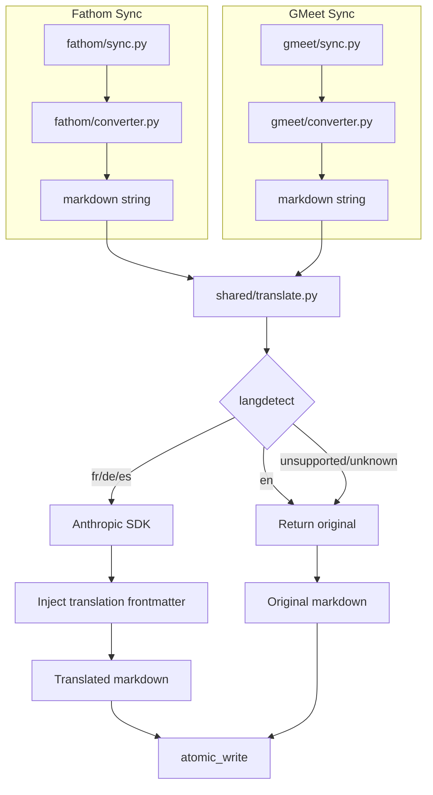

# Design: Transcript Translation

## Overview

Translation is implemented as a shared post-processing step that runs after markdown generation and before file writing in both the Fathom and GMeet sync pipelines. Language detection uses the `langdetect` library (lightweight, offline, no API cost) on a sample of the markdown body. Translation uses the Anthropic Python SDK with Claude, configured to preserve markdown formatting, speaker names, timestamps, and structural elements. The feature is opt-in via a `--translate` CLI flag and supports routing API calls through a custom AI gateway via `ANTHROPIC_BASE_URL`.

**Key design decisions:**

- **Detection before translation**: `langdetect` runs offline and fast — only transcripts confirmed as fr/de/es hit the Claude API, keeping costs predictable.
- **Translate the markdown body, not raw source data**: Translating after `meeting_to_markdown()` means one translation path for both connectors, and structural formatting (headings, bullets, block anchors) is already in place for the prompt to preserve.
- **Frontmatter is never translated**: YAML metadata (title, participants, tags) stays as-is. Translation metadata fields are injected into the frontmatter after translation.
- **Graceful fallback**: If translation fails, the original content is written with a warning in frontmatter — no meetings are lost.

## Architecture



**Key Architectural Principles:**

- **Single translation module**: Both connectors call the same `translate_markdown()` function — no duplication
- **Opt-in only**: Translation is disabled by default; `--translate` must be passed explicitly
- **Fail-open**: Translation errors never block the export pipeline

## Components and Interfaces

### TranslationConfig

Configuration for the translation feature, loaded from environment variables.

```typescript
interface TranslationConfig {
  enabled: boolean;              // From --translate CLI flag
  api_key: string;               // ANTHROPIC_API_KEY
  base_url: string | null;       // ANTHROPIC_BASE_URL (AI gateway), null = direct API
  model: string;                 // Default: "claude-sonnet-4-6"
  supported_languages: string[]; // ["fr", "de", "es"]
}
```

### translate_markdown() — Main Entry Point

**Module**: `shared/translate.py`

```python
def translate_markdown(
    markdown: str,
    config: TranslationConfig,
) -> TranslationResult:
```

**Logic:**

1. Split `markdown` into frontmatter (YAML between `---` delimiters) and body
2. Call `detect_language(body)` — samples beginning, middle, and end of body text
3. If all samples are `en` or unsupported → return original unchanged
4. If any sample detects `fr`, `de`, or `es` with sufficient coverage (>10% of text) → call `_translate_body(body, detected_languages, config)`
5. Inject `original_language`, `translated: true` into frontmatter
6. Prepend `> Auto-translated from [Language]` note after frontmatter (or `> Auto-translated (mixed: French, German)` for multi-language)
7. Return `TranslationResult` with translated markdown and metadata

### detect_language()

**Module**: `shared/translate.py`

```python
def detect_language(text: str) -> DetectionResult:
```

- Strips markdown formatting (headings, bullets, timestamps, speaker names, block anchors) to extract plain prose
- Splits the cleaned text into 3 equal-sized sections (beginning, middle, end) and runs `langdetect.detect_langs()` on each
- This multi-section approach catches mid-meeting language switches (e.g., first half English, second half French)
- Aggregates results: if any section detects a supported non-English language at >0.7 confidence, and that language covers >10% of the total text, the transcript is flagged for translation
- Returns `DetectionResult` with primary `language`, `confidence`, and a `detected_languages` list for multi-language cases
- `langdetect` is deterministic when seeded (`DetectorFactory.seed = 0`)
- If no section meets the confidence threshold or detection fails → returns `language="en"` (assume English, don't translate)

### _translate_body()

**Module**: `shared/translate.py` (private)

```python
def _translate_body(
    body: str,
    detected_languages: list[str],
    config: TranslationConfig,
) -> str:
```

- Creates an `anthropic.Anthropic` client with `api_key` and optional `base_url`
- Sends a single `messages.create()` call with a system prompt instructing Claude to:
  - Translate all non-English content to English (languages present: `detected_languages`)
  - Keep any already-English sections as-is
  - Preserve all markdown formatting (headings, bullets, bold, links)
  - Preserve speaker names, timestamps, block anchors (`^t-N`) verbatim
  - Preserve any Obsidian-specific syntax
  - Return only the translated text, no preamble
- The prompt handles mixed-language content naturally: Claude sees the full body and translates whatever isn't English, regardless of where the language switches occur
- Uses `claude-sonnet-4-6` by default (fast, cost-effective for translation)
- `max_tokens` set to `len(body) * 3` (translation rarely expands beyond 2x, buffer for safety), capped at 16384

### TranslationResult

```typescript
interface TranslationResult {
  markdown: string;              // The (possibly translated) markdown content
  translated: boolean;           // Whether translation was performed
  source_language: string;       // Primary detected language code ("en", "fr", "de", "es", "unknown")
  detected_languages: string[];  // All non-English languages found (e.g., ["fr", "de"] for mixed)
  confidence: float;             // Detection confidence 0.0–1.0
  error: string | null;          // Error message if translation failed
}
```

### DetectionResult

```typescript
interface DetectionResult {
  language: string;              // Primary ISO 639-1 code ("en", "fr", "de", "es") or "unknown"
  confidence: float;             // 0.0–1.0
  detected_languages: string[];  // All non-English supported languages found across sections
  needs_translation: boolean;    // True if any section has >10% non-English supported language
}
```

## Integration Points

### Fathom sync.py

In `run_sync()`, after `markdown = meeting_to_markdown(meeting)` and before `atomic_write()`:

```python
if translate_config and translate_config.enabled:
    result = translate_markdown(markdown, translate_config)
    markdown = result.markdown
    if result.translated:
        log.info("Translated from %s: %s", result.source_language, title)
    elif result.error:
        log.warning("Translation failed for '%s': %s", title, result.error)
```

Same pattern in `export_single()`.

### GMeet sync.py

Identical integration point in `run_sync()`, after `markdown = meeting_to_markdown(match)`.

### CLI (cli.py)

Add `--translate` flag to both `fathom sync` and `gmeet sync` commands:

```python
@click.option("--translate", is_flag=True, help="Translate non-English transcripts to English")
```

Build `TranslationConfig` from the flag + environment variables and pass to `run_sync()`.

## Frontmatter Injection

When a transcript is translated, the following fields are added to the existing YAML frontmatter:

```yaml
---
title: "Réunion d'équipe"           # Original title preserved
date: 2026-05-15
type: fathom-transcript
source: fathom
original_language: fr
translated: true
# ... rest of existing fields
---

> *Auto-translated from French*

## Summary
...
```

For mixed-language transcripts (mid-meeting language switch):

```yaml
---
original_language: fr
original_languages:
  - fr
  - de
translated: true
---

> *Auto-translated from French, German*

## Summary
...
```

When translation fails:

```yaml
---
original_language: fr
translated: false
translation_error: "API timeout after 30s"
---
```

## Error Handling

### Translation Errors

| Error | Condition | Recovery |
|-------|-----------|----------|
| Missing API key | `--translate` enabled, `ANTHROPIC_API_KEY` not set | Exit with clear error message before sync starts |
| API timeout | Claude API does not respond within 60s | Write original content, set `translation_error` in frontmatter, log warning |
| API error (4xx/5xx) | Claude API returns error response | Write original content, set `translation_error` in frontmatter, log warning |
| Rate limit (429) | Anthropic rate limit hit | Retry once after 10s; if still failing, write original + warning |
| Detection failure | `langdetect` throws exception | Treat as `language="unknown"`, skip translation, log debug |
| Empty body | No translatable text content | Skip translation, return original |

### Recovery Strategy

- **Translation is never blocking**: if it fails, the original content is written. The meeting is still marked as exported in SyncState.
- **No retry loop**: a single retry on 429, then fallback. Batch syncs with many meetings shouldn't hammer the API.
- **Frontmatter tagging on failure**: `translated: false` + `translation_error` allows future tooling to identify and retry failed translations.

## Dependencies

| Package | Purpose | Version |
|---------|---------|---------|
| `langdetect` | Offline language detection | `^1.0.9` |
| `anthropic` | Claude API SDK | `>=0.40.0` |

Both added to `pyproject.toml` as optional dependencies under a `[translate]` extra:

```toml
[project.optional-dependencies]
translate = ["langdetect>=1.0.9", "anthropic>=0.40.0"]
```

This keeps the base install lightweight for users who don't need translation.

## Testing Strategy

### Unit Tests

- **`test_translate.py`**:
  - `detect_language()`: French text → `fr`; English text → `en`; empty text → `en` (default)
  - `detect_language()` with mixed content: English first half + French second half → `needs_translation=True`, `detected_languages=["fr"]`
  - `detect_language()` with multi-language: French + German sections → `detected_languages=["fr", "de"]`
  - `translate_markdown()` with mocked Anthropic client: frontmatter preserved, translation metadata injected, body translated
  - `translate_markdown()` with mixed-language frontmatter: `original_languages` list populated correctly
  - `translate_markdown()` with API failure: returns original content with error metadata
  - Frontmatter splitting: handles edge cases (no frontmatter, empty body, multi-line YAML values)

### Integration Tests

- Manual: `meeting-export fathom sync --translate --dry-run` with French transcript in Fathom
- Manual: `meeting-export gmeet sync --translate --limit 1` with German Gemini notes

### Test Organization

- Location: `tests/unit/test_translate.py`
- Framework: `pytest` (consistent with existing tests)
- Mocking: `unittest.mock.patch` for Anthropic client
